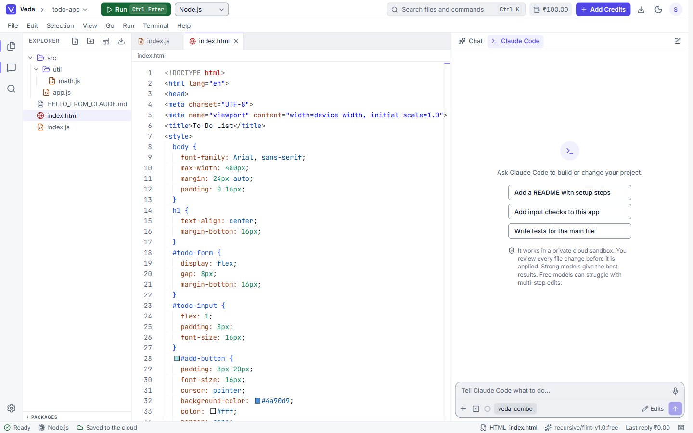
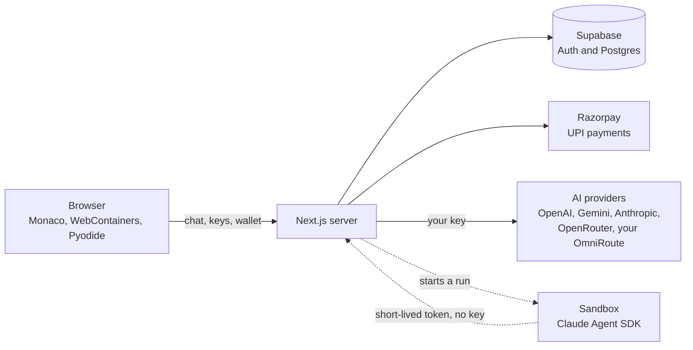
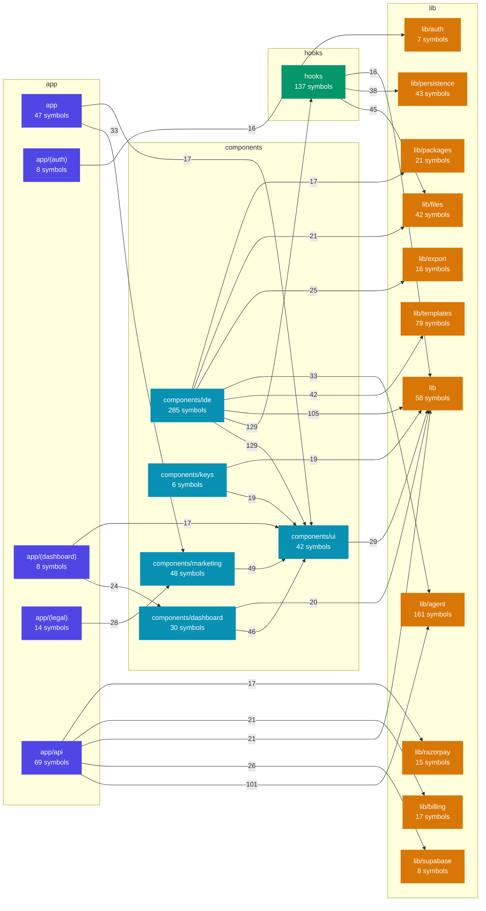

<div align="center">

# Veda

**Code with AI. Pay in rupees.**

A browser IDE for Indian college students. Write and run code in the tab, bring your own AI key,
and top up a wallet with UPI from ₹29. No international card needed.

[](LICENSE)
[](https://github.com/siddiqbarbhuiya/Veda/stargazers)
[](https://github.com/siddiqbarbhuiya/Veda/commits/main)
[](https://github.com/siddiqbarbhuiya/Veda/issues)
[](#contributing)

[](https://nextjs.org)
[](https://react.dev)
[](https://www.typescriptlang.org)
[](https://tailwindcss.com)
[](https://supabase.com)
[](https://vitest.dev)

[**Live demo**](https://veda-ecru-theta.vercel.app) &nbsp;|&nbsp;
[Features](#features) &nbsp;|&nbsp;
[Quick start](#quick-start) &nbsp;|&nbsp;
[Docs](#docs) &nbsp;|&nbsp;
[Roadmap](#roadmap)

<br />

<a href="https://veda-ecru-theta.vercel.app">
  <picture>
    <source media="(prefers-color-scheme: dark)" srcset="docs/screenshots/ide-dark.jpg">
    
  </picture>
</a>

</div>

<br />

## Why Veda

Most AI coding tools bill in dollars on an international card. Many students in India have neither.
Veda is a full editor in the browser, and it takes the cost out of the way:

- **Bring your own key.** The AI provider bills you directly. Veda charges only for the in-app AI calls, in rupees.
- **UPI wallet.** Top up from ₹29 (packs of ₹29, ₹49 and ₹99 with a ₹10 bonus). A failed call costs ₹0.
- **Nothing to install.** Node.js and Python run inside the browser tab, on the student's own computer.

> **Status:** MVP (v0.1). Some parts are rough. Issues and ideas are welcome.

## Features

| | |
|---|---|
| **Browser IDE** | Monaco editor, file tree, tabs, command palette (`Ctrl+K`), resizable panels, dark and light themes, a live preview panel and an integrated terminal. |
| **Runs real code** | Node.js and `npm` in WebContainers. Python and `pip` in Pyodide. Package search and add from the Explorer. |
| **7 starter templates** | Node script, Python, Express server, Vite + React, React + FastAPI, React + TypeScript + Express, React + TypeScript + FastAPI. |
| **AI chat** | Streaming answers with the cost shown, a searchable model list, file attachments, voice dictation, and `/compact` to free context. |
| **Many providers** | OpenAI, Gemini, Anthropic and OpenRouter. Or your own [OmniRoute](docs/setup/omniroute.md) with your own combos. |
| **Model combos** | An ordered list of models. When one hits a limit, the next one answers. |
| **Claude Code tab** *(experimental)* | The real Claude Agent SDK edits your project in a sandbox. You review each change as a diff and accept or reject it. Four permission modes. See [setup](docs/setup/claude-code-sandbox.md). |
| **Safe by design** | API keys are encrypted with AES-256-GCM. In the default mode keys never enter the sandbox. A circuit breaker stops runaway token costs. |
| **Your work is kept** | Projects save in the browser and sync to your account. Export everything as a ZIP. |
| **Built for India** | Pay with UPI through Razorpay (or a simulator in development). Indic fonts and correct IME input for Hindi, Bengali and Tamil. |

## How it works



Code runs in the browser, so a student's project costs Veda no server time. The server holds the encrypted keys,
the wallet and the AI proxy.

## Quick start

You need Node.js 20.9 or newer and a free [Supabase](https://supabase.com) project.

```bash
git clone https://github.com/siddiqbarbhuiya/Veda.git
cd Veda
npm install
cp .env.example .env.local   # then fill in the values
npm run dev                  # http://localhost:3000
```

1. Fill `.env.local`. The [environment guide](docs/setup/environment.md) walks through each value.
2. Apply the SQL files in `supabase/migrations/` to your Supabase project, in order.
3. Open <http://localhost:3000>, sign in with GitHub or Google, and add an AI key in the dashboard.

Payments run in **simulator mode** by default, so you can try the wallet without a Razorpay account.

### Scripts

| Command | What it does |
|---|---|
| `npm run dev` | Start the dev server. |
| `npm run build` | Build for production. |
| `npm test` | Run the unit tests (Vitest). |
| `npx tsc --noEmit` | Type-check. |
| `npm run lint` | Run ESLint. |
| `npm run rotate-keys` | Re-encrypt stored keys after you change `ENCRYPTION_SECRET`. |

### Configuration

| Variable | Required | Description |
|----------|----------|-------------|
| `NEXT_PUBLIC_SUPABASE_URL` | yes | Supabase project URL |
| `NEXT_PUBLIC_SUPABASE_ANON_KEY` | yes | Supabase anon key |
| `SUPABASE_SERVICE_ROLE_KEY` | yes | Supabase service role key (server only) |
| `ENCRYPTION_SECRET` | yes | 32-byte hex string for AES-256-GCM |
| `PAYMENT_MODE` | yes | `simulator` or `live` |
| `NEXT_PUBLIC_APP_URL` | yes | App URL, for example `http://localhost:3000` |
| `RAZORPAY_KEY_ID`, `RAZORPAY_KEY_SECRET`, `RAZORPAY_WEBHOOK_SECRET` | live mode | Razorpay keys. Not needed in simulator mode. |
| `E2B_API_KEY`, `AGENT_PUBLIC_URL` | Claude Code | Sandbox for the Claude Code tab. See [its guide](docs/setup/claude-code-sandbox.md). |

Students add their own AI keys in the dashboard, so no AI key goes in `.env.local`.

## How the IDE runs your code

| Part | Where it happens |
|---|---|
| Editor | Monaco, in the browser tab. |
| Node.js and `npm install` | WebContainers: Node.js runs inside the tab (WebAssembly), on the student's own CPU and memory. |
| Python | Pyodide, in the tab. |
| Terminal | `jsh`, the WebContainers shell. It is not bash: no `apt`, no native programs and no Docker. |
| Project files | In the browser (IndexedDB), saved every 5 seconds, and synced to your account (up to 5 MB for each project). |

If you clear site data and were never signed in, the browser copy is gone. **Export project as ZIP** (the download icon, or
`Ctrl+K`) keeps a backup. The ZIP holds the editor files, the files your code made in the Node.js runtime, and optionally
`node_modules`. Python packages installed in the browser are not included.

## Architecture map

The map below shows how the code folders in `src/` depend on each other. A box is a folder with its number of
symbols. An arrow is a dependency, and its number is how many imports and calls there are. It updates on each push to
`main` that changes `src/`, from the graphify knowledge graph (`scripts/graph-mermaid.mjs`).

<!-- graph:start -->

<!-- graph:end -->

## Project structure

```text
src/
  app/            Next.js routes: landing, login, dashboard, IDE, and the API (keys, wallet, AI chat, agent)
  components/     UI: ide/ (editor, panels, composer), dashboard/, keys/, payments/, marketing/, ui/
  hooks/          use-file-system, use-webcontainer, use-pyodide, use-ai-chat, use-agent
  lib/            ai-providers, agent (Claude Code), billing, crypto, razorpay, persistence, templates, omniroute
supabase/         SQL migrations
docs/             setup guides, design system, product notes
```

## Docs

- [Environment setup, step by step](docs/setup/environment.md)
- [Claude Code tab setup](docs/setup/claude-code-sandbox.md)
- [Bring your own OmniRoute](docs/setup/omniroute.md)
- [Design system](docs/design-system.md) and [editor product notes](docs/product/editor-prd.md)
- [Design specification](docs/specs/2026-10-29-veda-mvp-design.md) and [changelog](CHANGELOG.md)

## Roadmap

Ideas from the [product notes](docs/product/editor-prd.md). They are plans, not promises.

- [ ] VS Code workbench with Open VSX extensions
- [ ] Git clone, commit and push to GitHub
- [ ] Environment variables and secrets for a project
- [ ] Share link, fork and embed
- [ ] Pricing for the Claude Code sandbox, and a hosted sandbox for everyone

## Contributing

Contributions are welcome.

1. Fork the repository and create a feature branch.
2. Run `npm test`, `npx tsc --noEmit` and `npm run lint` before you push.
3. Open a pull request against `main`.

If Veda helps you, a star on the repo helps others find it.

## License

[MIT](LICENSE) &copy; 2026 Siddiq Barbhuiya.

## Acknowledgements

Built on [Next.js](https://nextjs.org), [Monaco](https://microsoft.github.io/monaco-editor/),
[WebContainers](https://webcontainers.io), [Pyodide](https://pyodide.org), [Supabase](https://supabase.com),
[Razorpay](https://razorpay.com) and the [Claude Agent SDK](https://docs.claude.com).
