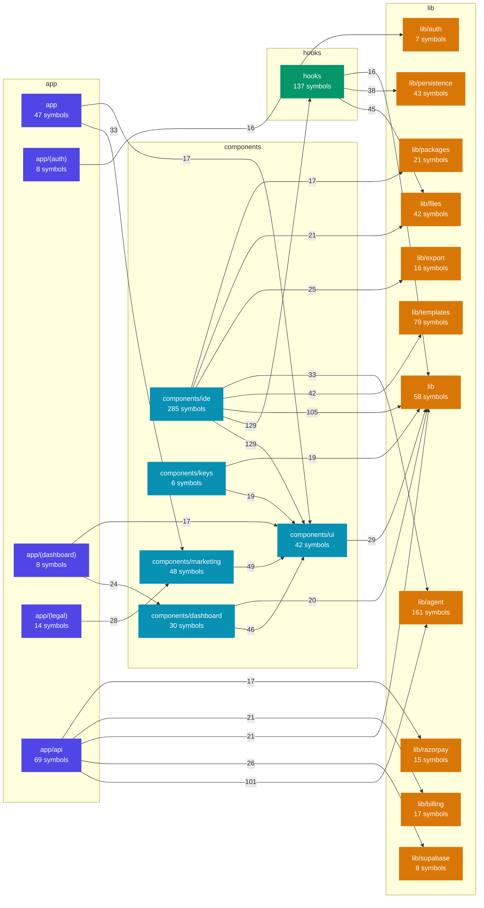

# Veda

A BYOK AI coding playground for Indian college students. Code runs in the browser. Students bring their own AI keys and pay with UPI from ₹29.

## Features
- Browser IDE: Monaco, file tree, terminal. Node.js (WebContainers) and Python (Pyodide).
- AI chat with streaming and cost display.
- Encrypted API key storage (AES-256-GCM).
- UPI top-ups through Razorpay, with a simulator mode.
- Circuit breaker against runaway token costs.

## Tech stack
Next.js 16 (App Router), React 19, TypeScript, Tailwind CSS 4, Supabase (Auth, Postgres), Razorpay, Vitest.

## Quick start
1. Clone the repository.
2. Run `npm install`.
3. Copy `.env.example` to `.env.local` and fill the values. See [docs/setup/environment.md](docs/setup/environment.md).
4. Apply the SQL files in `supabase/migrations/` to your Supabase project.
5. Run `npm run dev`.
6. Open http://localhost:3000.

## Scripts
- `npm run dev` - start the dev server.
- `npm test` - run the tests.
- `npm run rotate-keys` - re-encrypt stored keys after you change `ENCRYPTION_SECRET`.

## Usage

```typescript
// Browser hook — file system backed by IndexedDB
import { useFileSystem } from "@/hooks/use-file-system";
const { files, createFile, readFile, writeFile, deleteFile } = useFileSystem();

// Server — encrypt and store an API key
import { encrypt } from "@/lib/crypto/encryption";
const payload = encrypt(rawKey); // { encrypted, iv, authTag }

// Server — calculate AI usage cost in paise
import { calculateCostPaise } from "@/lib/billing/cost";
const cost = calculateCostPaise(inputTokens, outputTokens, rate);
```

## Configuration

| Variable | Required | Description |
|----------|----------|-------------|
| `NEXT_PUBLIC_SUPABASE_URL` | yes | Supabase project URL |
| `NEXT_PUBLIC_SUPABASE_ANON_KEY` | yes | Supabase anon key |
| `SUPABASE_SERVICE_ROLE_KEY` | yes | Supabase service role key (server only) |
| `ENCRYPTION_SECRET` | yes | 32-byte hex string for AES-256-GCM |
| `RAZORPAY_KEY_ID` | no | Razorpay API key (not needed in simulator mode) |
| `RAZORPAY_KEY_SECRET` | no | Razorpay secret (not needed in simulator mode) |
| `RAZORPAY_WEBHOOK_SECRET` | no | Webhook secret for payment verification |
| `PAYMENT_MODE` | yes | `simulator` or `live` |
| `NEXT_PUBLIC_APP_URL` | yes | App URL, e.g. `http://localhost:3000` |

See [docs/setup/environment.md](docs/setup/environment.md) for the full setup guide.

## How the IDE runs your code

| Part | Where it happens |
|---|---|
| Editor | Monaco, in the browser tab. |
| Node.js and `npm install` | WebContainers. Node.js runs inside the browser tab (WebAssembly). It uses the student's own CPU and memory. |
| Python | Pyodide, in the browser tab. |
| Terminal | `jsh`, the WebContainers JavaScript shell. It is not bash. There is no `apt`, no native program and no Docker. |
| Project files | **Only in the browser** (IndexedDB), saved every 5 seconds. Nothing goes to a server. |

Because the files are only in the browser, a student who clears site data or changes device loses the project.
Use **Export project as ZIP** (the download icon in the toolbar, or Ctrl+K and "Export project as ZIP") to keep a backup.
The ZIP has the editor files, the files that your code made in the Node.js runtime, and optionally `node_modules`.
Python packages installed in the browser are not included.

## Knowledge Graph

The map below shows how the code folders in `src/` depend on each other. A box is a folder with its number of
symbols. An arrow is a dependency, and its number is how many imports and calls there are. It updates on each push to
`main` that changes `src/`, from the graphify knowledge graph (`scripts/graph-mermaid.mjs`).

<!-- graph:start -->

<!-- graph:end -->

## Docs
- [Environment setup (step by step, for beginners)](docs/setup/environment.md)
- [Design specification](docs/specs/2026-10-29-veda-mvp-design.md)
- [Implementation plan](docs/superpowers/plans/2026-10-29-veda-mvp.md)

## Contributing

1. Fork the repository and create a feature branch.
2. Run `npm test` and `npx tsc --noEmit` before you push.
3. Open a pull request against `main`.

## License
TBD.
